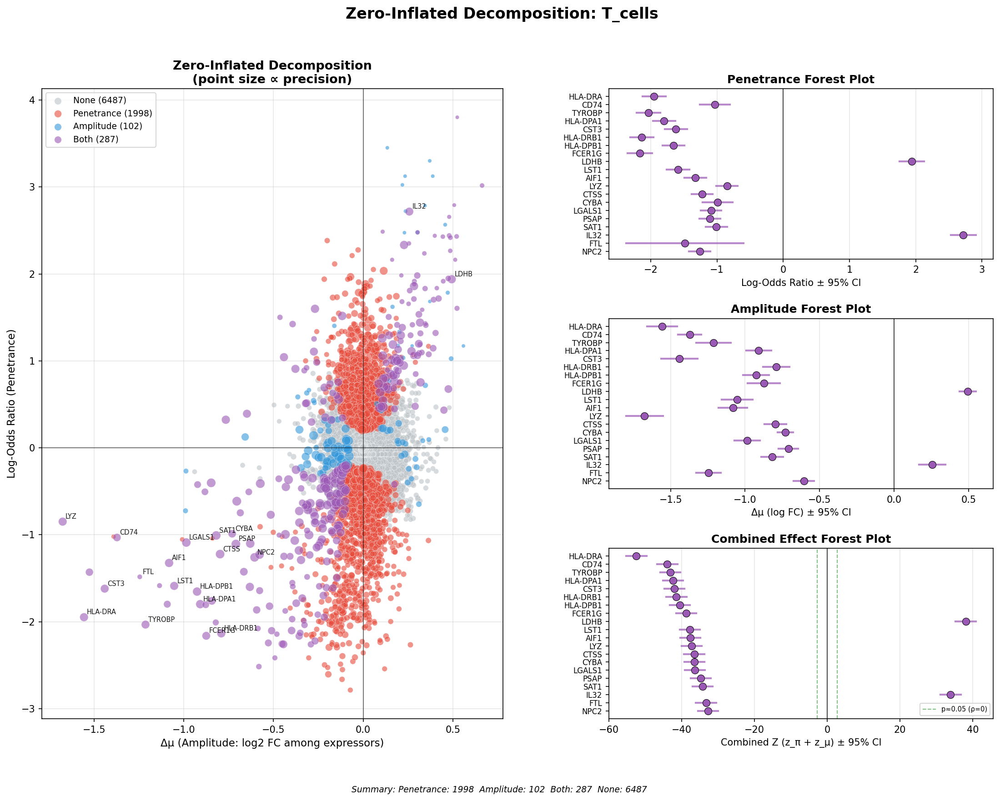

# scanpy-zi

Decompose single-cell differential expression into penetrance and amplitude effects.

[](https://pypi.org/project/scanpy-zi/)
[](https://opensource.org/licenses/MIT)

## Motivation

Standard differential expression methods report a single fold-change per gene. In single-cell data, this conflates two sources of variation:

1. **Fraction of cells expressing**: changes in the proportion of cells with detectable transcripts
2. **Expression level among expressors**: changes in abundance conditional on expression

### Zeros in scRNA-seq

Zeros in scRNA-seq arise from a mixture of technical and biological sources. Technical zeros (dropout) occur when a transcript is present but not captured due to inefficient lysis, reverse transcription, or amplification. Biological zeros occur when a gene is not transcribed in a given cell, whether due to chromatin state, absence of required transcription factors, or cell type identity.

The relative contribution of these sources varies by gene and technology. However, for genes with high zero rates, the zeros are predominantly biological. If dropout were the dominant source, we would expect zeros to be roughly uniform across genes at a given expression level. Instead, zero rates vary dramatically across genes even at similar mean expression, suggesting biological non-expression as a major component (Sarkar & Stephens 2021).

This has implications for differential expression. When comparing two conditions, a change in the fraction of zeros may reflect:

- More cells initiating transcription (biological)
- Differences in capture efficiency between conditions (technical)
- Some combination of both

For highly sparse genes, the biological interpretation is more defensible: if 95% of cells show zero expression, the 5% with detectable transcripts likely represent a distinct subpopulation rather than lucky capture events.

### The decomposition

scanpy-zi separates differential expression into two components:

| Effect | Measures | Statistic |
|--------|----------|-----------|
| **Δπ** (penetrance) | Change in fraction expressing | Log-odds ratio |
| **Δμ** (amplitude) | Change in expression level | Difference in mean (log-scale) expression among expressors |

Each component has a separate effect size, confidence interval, and p-value. A joint Wald test provides overall significance while preserving the decomposition.

The terminology follows a biological framing:

- **Penetrance**: in how many cells is this gene active?
- **Amplitude**: given that a gene is active, how strongly is it expressed?

### Zero-inflated models

Zero-inflated regression models have been applied across many domains with excess zeros: ecology (species counts), insurance (claim frequency), public health (disease incidence), and manufacturing (defect counts). The statistical framework is well established. scanpy-zi applies these methods to single-cell transcriptomics, where the structure of the data (sparse counts, biological non-expression) fits the modeling assumptions.

## Installation
```bash
pip install scanpy-zi
```

## Usage
```python
import scanpy as sc
import scanpy_zi

# Load and normalize data
adata = sc.read_h5ad("your_data.h5ad")
sc.pp.normalize_total(adata, target_sum=1e4)
sc.pp.log1p(adata)

# All groups vs rest (one pass over the matrix)
results = scanpy_zi.rank_genes_groups_zi(
    adata,
    groupby="celltype",
    reference="rest",
    use_raw=False,
    copy=True,
)

# Or a single group
results = scanpy_zi.rank_genes_groups_zi(
    adata, groupby="celltype", groups=["T cells"], use_raw=False, copy=True
)

# Top genes by combined significance
results.nsmallest(20, "pvals_adj")

# Genes with significant penetrance (FDR < 0.05)
results.query("pvals_pi_adj < 0.05")

# Genes with significant amplitude (FDR < 0.05)
results.query("pvals_mu_adj < 0.05")

# Visualization
scanpy_zi.pl.zi_decomposition(adata)
```



## Output

| Column | Description |
|--------|-------------|
| `delta_pi` | Penetrance effect (log-odds ratio) |
| `se_delta_pi` | Standard error of penetrance |
| `delta_pi_ci_lower` | 95% CI lower bound |
| `delta_pi_ci_upper` | 95% CI upper bound |
| `pvals_pi_adj` | FDR-adjusted p-value for penetrance |
| `delta_mu` | Amplitude effect: difference in mean input value among expressors (input units, see below) |
| `se_delta_mu` | Standard error of amplitude |
| `delta_mu_ci_lower` | 95% CI lower bound |
| `delta_mu_ci_upper` | 95% CI upper bound |
| `pvals_mu_adj` | FDR-adjusted p-value for amplitude |
| `pvals_adj` | Combined FDR-adjusted p-value (Wald test) |
| `combined_z` | Combined z-score: z_π + z_μ (signed) |
| `wald_statistic` | z_π² + z_μ² (χ², 2 df) |
| `pct_nz_group`, `pct_nz_reference` | Fraction of cells expressing |

Rows are sorted within each group by combined p-value.

## Input expectations

Values are used exactly as given; scanpy-zi applies no transform. Pass normalized,
log-transformed data (for example `sc.pp.normalize_total` then `sc.pp.log1p`) and do not
log-transform again before calling. A warning is raised if the input looks like raw integer
counts.

`delta_mu` (and its alias `logfoldchanges`) is in the units of the input. For `sc.pp.log1p`
output that is natural log: `delta_mu` is the difference in mean ln(1 + x) among expressing
cells. Divide by ln(2) ≈ 0.693 for log2 units. It is not the log of a ratio of mean expression,
which is what `sc.tl.rank_genes_groups` reports as `logfoldchanges`.

## Group-vs-rest comparisons

Some implementations of zero-inflated models restrict analysis to pairwise group comparisons, on the grounds that the "rest" category is heterogeneous.

The log-odds ratio and mean difference remain well-defined statistics regardless of reference group heterogeneity. They estimate the aggregate difference between your group of interest and the background population.

The limitation is interpretive: group-vs-rest cannot distinguish whether a marker is unique to your group or shared with a subset of the reference. Pairwise comparisons are necessary to establish specificity.

## Method

**Penetrance**: Log-odds ratio from the 2×2 contingency table (expressing/non-expressing × group/reference). Haldane correction (+0.5) applied when any cell count is zero.

**Amplitude**: Mean difference among expressing cells, tested with a pooled-variance two-sample t-test (equivalent to OLS on a group indicator).

**Combined test**: Wald statistic W = z_π² + z_μ², χ² with 2 df (1 df when only one component is testable). The two estimators are uncorrelated: within a group, penetrance depends only on the number of expressing cells N, and given N the mean among expressors is unbiased, so their covariance is zero by the law of total covariance. No correlation term is needed.

**Filtering (`min_cells`)**: Amplitude requires at least `min_cells` expressing cells in each group. Penetrance requires at least `min_cells` expressing cells in the two groups combined, so genes that are on in one group and off in the other are still tested. Untestable components get p-value 1. Amplitude is also untestable when every expressing cell has the same value (zero variance).

**Implementation**: One pass over the stored values of the matrix aggregates expressor counts, sums and sums of squares for every requested group at once (float64, `np.bincount`). "Rest" statistics are totals minus the group. All per-gene statistics are vectorized. The matrix is never densified or copied; on a 46k-cell × 16.6k-gene matrix (73M non-zeros) all 35 groups vs rest take about 2 s.

### Limitations

- Amplitude is undefined for genes with fewer than `min_cells` expressors in either group (reported as `NaN`).
- When a gene has zero expressors (or zero non-expressors) in a group, the Haldane-corrected log-odds has a wide standard error, so on/off markers get moderate rather than extreme penetrance p-values.
- The amplitude test assumes equal variance among expressors in the two groups. With group-vs-rest comparisons the reference is a mixture and may be more variable.
- Input should be log-normalized. Count data should be normalized before analysis.
- The decomposition assumes zeros represent non-expression. For genes with substantial technical dropout, penetrance estimates will be attenuated.

## References

- Townes FW, Hicks SC, Aryee MJ, Irizarry RA (2019). Feature selection and dimension reduction for single-cell RNA-Seq based on a multinomial model. *Genome Biology* 20:295. [doi:10.1186/s13059-019-1861-6](https://doi.org/10.1186/s13059-019-1861-6)

- Sarkar A, Stephens M (2021). Separating measurement and expression models clarifies confusion in single-cell RNA sequencing analysis. *Nature Genetics* 53:770-777. [doi:10.1038/s41588-021-00873-4](https://doi.org/10.1038/s41588-021-00873-4)

## Citation
```bibtex
@software{scanpy_zi,
  author = {Bryan Downie},
  organization = {Node Biosciences},
  title = {scanpy-zi: Zero-inflated decomposition for single-cell differential expression},
  url = {https://github.com/node-bio/scanpy-zi}
}
```

## License

MIT